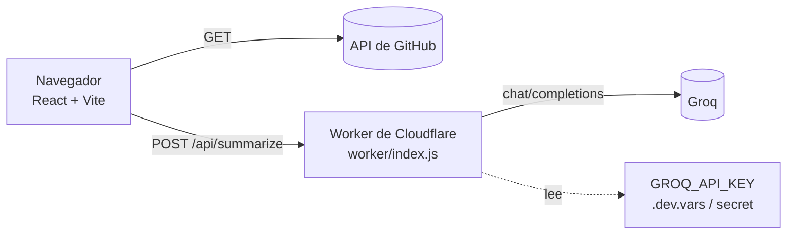

<div align="center">


# Scan my Repo

**Pega un repositorio público de GitHub y obtén un reporte visual con resumen de IA y una calificación de 1 a 5.**


Proyecto Informático · Universidad Autónoma de Occidente (UAO) · 2026

</div>

---

## Qué hace

1. Escribes `usuario/repo` o la URL completa (`https://github.com/usuario/repo`).
2. La app consulta la API pública de GitHub desde el navegador.
3. Muestra el reporte: **lenguajes**, **commits por semana**, **contribuidores** e **issues**.
4. Envía un resumen de los datos al Worker de Cloudflare, que llama a Groq y devuelve **resumen, calificación (1 a 5), fortalezas y mejoras**.

## Estado del proyecto

| Pieza                                                 | Estado                                        |
| ----------------------------------------------------- | --------------------------------------------- |
| Búsqueda (`usuario/repo` o URL)                       | ✅                                            |
| Reporte con datos reales de GitHub                    | ✅                                            |
| Gráficas (lenguajes, commits, contribuidores, issues) | ✅                                            |
| Resumen y calificación con IA (Worker + Groq)         | ✅                                            |
| Historial persistente                                 | ⏳ stub (`TODO` en `features/history`)        |
| Exportar reporte a PNG / README                       | ⏳ stub (`TODO` en `features/export`)         |
| Despliegue en producción                              | ⏳ pendiente (ver [Despliegue](#-despliegue)) |

## Arquitectura



- **GitHub se consulta desde el navegador**, sin token. Por eso aplica el límite anónimo de GitHub (60 peticiones por hora por IP). Si lo superas, la app muestra un aviso de límite alcanzado.
- **La clave de Groq nunca llega al navegador.** Solo vive en el Worker.
- En desarrollo, Vite hace proxy de `/api` hacia `http://localhost:8787`, donde corre el Worker (`vite.config.js`).

## Puesta en marcha

### Requisitos

- Node.js 20 o superior
- Una API key de Groq → [console.groq.com/keys](https://console.groq.com/keys)
- No necesitas cuenta de Cloudflare para correr en local. Solo para desplegar.

### 1. Instalar dependencias

```bash
npm install
```

### 2. Configurar variables de entorno

Crea el archivo `.dev.vars` en la raíz del proyecto (está en `.gitignore`, no se sube al repo):

```bash
echo 'GROQ_API_KEY=pega_tu_clave_aqui' > .dev.vars
```

| Variable       | Dónde se define                                         | Obligatoria | Descripción                                        |
| -------------- | ------------------------------------------------------- | :---------: | -------------------------------------------------- |
| `GROQ_API_KEY` | `.dev.vars` (local) · secret de Cloudflare (producción) |     Sí      | Clave de la API de Groq. Solo la lee el Worker.    |
| `GROQ_MODEL`   | `wrangler.jsonc` → `vars`                               |     No      | Modelo de Groq. Por defecto `openai/gpt-oss-120b`. |

> ⚠️ No uses el prefijo `VITE_` para la clave: Vite la metería en el bundle del navegador. El proyecto ya no expone variables `GROQ_*` al cliente.

### 3. Levantar frontend y Worker

Necesitas **dos terminales**, ambas en la raíz del proyecto:

```bash
# Terminal 1: Worker (API de IA) en http://localhost:8787
npx wrangler dev

# Terminal 2: frontend en http://localhost:5173
npm run dev
```

Abre http://localhost:5173 y prueba con un repositorio, por ejemplo `facebook/react`.

> Si solo corres el frontend, el reporte de GitHub funciona pero el resumen de IA falla con «No pudimos conectar con el servicio de IA».

### 4. Verificar que todo funciona

```bash
# El Worker responde (debe devolver 400 con la lista de campos inválidos, no 404 ni 500)
curl -i -X POST http://localhost:8787/api/summarize -H 'Content-Type: application/json' -d '{}'

# Tipos y build de producción
npm run build
```

## Comandos

| Comando                    | Qué hace                                                               |
| -------------------------- | ---------------------------------------------------------------------- |
| `npm run dev`              | Frontend en http://localhost:5173                                      |
| `npx wrangler dev`         | Worker de IA en http://localhost:8787                                  |
| `npm run build`            | `tsc --noEmit` + `vite build` (genera `dist/`). Debe pasar sin errores |
| `npm run preview`          | Sirve el build de `dist/`                                              |
| `npx prettier --write src` | Formatea el código (sin `;`, comillas simples, ancho 120)              |

## Despliegue

El Worker se despliega con Wrangler. El nombre y la configuración están en `wrangler.jsonc`.

```bash
npx wrangler login                       # una sola vez
npx wrangler secret put GROQ_API_KEY     # guarda la clave como secret en Cloudflare
npx wrangler deploy                      # publica el Worker `scan-my-repo-api`
```

## Estructura

```
src/
├── pages/          HomePage, ReportPage (solo importan del index.ts de cada feature)
├── features/
│   ├── search/       SearchBar, parseo de usuario/repo o URL
│   ├── report/       datos de GitHub, gráficas y useRepoReport
│   ├── ai-summary/   AiSummary, ScoreMeter, llamada a /api/summarize
│   ├── history/      HistoryPanel (stub)
│   └── export/       exportación a PNG y README (stub)
├── shared/         components, hooks, constants, utils, mocks y types.ts
└── styles/         index.css (tokens de Tailwind y animaciones)
worker/
├── index.js        flujo: validar → llamar a Groq → limpiar respuesta
├── prompt.js       prompt de sistema y rúbrica de calificación
└── validate.js     validación de entrada y salida
docs/               CONTRATOS.md · IA.md · DESIGN.md
wrangler.jsonc      configuración del Worker
```

### Reglas del código

- Imports siempre con el alias `@/...`, nunca rutas relativas.
- Una feature nunca importa de otra. Las pages importan solo del `index.ts` de cada feature.
- `shared` no importa de `features` ni de `pages`.
- Todo componente recibe sus datos por props. Los servicios y hooks rechazan con `AppError` (mensaje en español listo para mostrar).

## Documentación

| Documento                                | Contenido                                                      |
| ---------------------------------------- | -------------------------------------------------------------- |
| [`docs/CONTRATOS.md`](docs/CONTRATOS.md) | Tipos de datos y firmas entre features                         |
| [`docs/IA.md`](docs/IA.md)               | Cómo se arma el prompt, el modelo y la rúbrica de calificación |
| [`docs/DESIGN.md`](docs/DESIGN.md)       | Guía de estilo visual                                          |

## Autores

Eddie Santiago Delgado Campo · Christian David Home Acero · Manuel Betancurt Pérez

## Licencia

Sin licencia definida todavía. Proyecto académico (Proyecto Informático, UAO, 2026).
