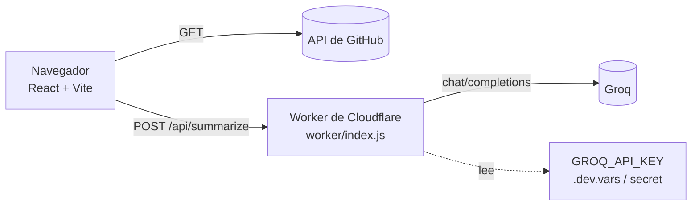
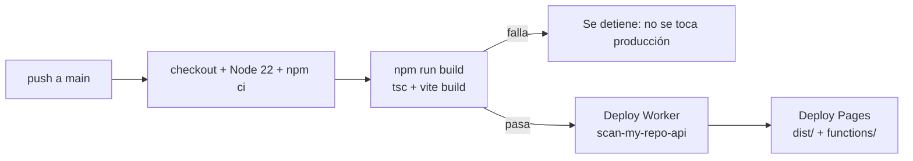

<div align="center">


# Scan my Repo

**Pega un repositorio público de GitHub y obtén un reporte visual con resumen de IA y una calificación de 1 a 5.**


Proyecto Informático · Universidad Autónoma de Occidente (UAO) · 2026

</div>

---

## Qué hace

1. Escribes `usuario/repo` o la URL completa (`https://github.com/usuario/repo`).
2. La app consulta la API pública de GitHub desde el navegador.
3. Muestra el reporte: **lenguajes**, **commits por semana**, **contribuidores** e **issues**.
4. Envía un resumen de los datos al Worker de Cloudflare, que llama a Groq y devuelve **resumen, calificación (1 a 5), fortalezas y mejoras**.

## Estado del proyecto

| Pieza                                                 | Estado                                                     |
| ----------------------------------------------------- | ---------------------------------------------------------- |
| Búsqueda (`usuario/repo` o URL)                       | ✅                                                         |
| Reporte con datos reales de GitHub                    | ✅                                                         |
| Gráficas (lenguajes, commits, contribuidores, issues) | ✅                                                         |
| Resumen y calificación con IA (Worker + Groq)         | ✅                                                         |
| Historial persistente (localStorage)                  | ✅                                                         |
| Exportar reporte a PNG / README                       | ✅                                                         |
| Despliegue automático (GitHub Actions → Cloudflare)   | ✅ ver [CI/CD](#cicd-con-github-actions)                   |
| Plan de pruebas E2E                                   | ✅ 52 de 55 pruebas pasan ([resultados](#plan-de-pruebas)) |

## Arquitectura



- **GitHub se consulta desde el navegador**, sin token. Por eso aplica el límite anónimo de GitHub (60 peticiones por hora por IP). Si lo superas, la app muestra un aviso de límite alcanzado.
- **La clave de Groq nunca llega al navegador.** Solo vive en el Worker.
- En desarrollo, Vite hace proxy de `/api` hacia `http://localhost:8787`, donde corre el Worker (`vite.config.js`).

## Puesta en marcha

### Requisitos

- Node.js 20 o superior
- Una API key de Groq → [console.groq.com/keys](https://console.groq.com/keys)
- No necesitas cuenta de Cloudflare para correr en local. Solo para desplegar.

### 1. Instalar dependencias

```bash
npm install
```

### 2. Configurar variables de entorno

Crea el archivo `.dev.vars` en la raíz del proyecto (está en `.gitignore`, no se sube al repo):

```bash
echo 'GROQ_API_KEY=pega_tu_clave_aqui' > .dev.vars
```

| Variable       | Dónde se define                                         | Obligatoria | Descripción                                        |
| -------------- | ------------------------------------------------------- | :---------: | -------------------------------------------------- |
| `GROQ_API_KEY` | `.dev.vars` (local) · secret de Cloudflare (producción) |     Sí      | Clave de la API de Groq. Solo la lee el Worker.    |
| `GROQ_MODEL`   | `wrangler.jsonc` → `vars`                               |     No      | Modelo de Groq. Por defecto `openai/gpt-oss-120b`. |

> ⚠️ No uses el prefijo `VITE_` para la clave: Vite la metería en el bundle del navegador. El proyecto ya no expone variables `GROQ_*` al cliente.

### 3. Levantar frontend y Worker

Necesitas **dos terminales**, ambas en la raíz del proyecto:

```bash
# Terminal 1: Worker (API de IA) en http://localhost:8787
npx wrangler dev

# Terminal 2: frontend en http://localhost:5173
npm run dev
```

Abre http://localhost:5173 y prueba con un repositorio, por ejemplo `facebook/react`.

> Si solo corres el frontend, el reporte de GitHub funciona pero el resumen de IA falla con «No pudimos conectar con el servicio de IA».

### 4. Verificar que todo funciona

```bash
# El Worker responde (debe devolver 400 con la lista de campos inválidos, no 404 ni 500)
curl -i -X POST http://localhost:8787/api/summarize -H 'Content-Type: application/json' -d '{}'

# Tipos y build de producción
npm run build
```

## Comandos

| Comando                    | Qué hace                                                               |
| -------------------------- | ---------------------------------------------------------------------- |
| `npm run dev`              | Frontend en http://localhost:5173                                      |
| `npx wrangler dev`         | Worker de IA en http://localhost:8787                                  |
| `npm run build`            | `tsc --noEmit` + `vite build` (genera `dist/`). Debe pasar sin errores |
| `npm run preview`          | Sirve el build de `dist/`                                              |
| `npx prettier --write src` | Formatea el código (sin `;`, comillas simples, ancho 120)              |

## Despliegue

En producción el despliegue lo hace el [workflow de GitHub Actions](#cicd-con-github-actions) con cada push a `main`. Lo siguiente sirve para la primera configuración o para desplegar a mano.

El Worker se despliega con Wrangler. El nombre y la configuración están en `wrangler.jsonc`.

```bash
npx wrangler login                       # una sola vez
npx wrangler secret put GROQ_API_KEY     # guarda la clave como secret en Cloudflare
npx wrangler deploy                      # publica el Worker `scan-my-repo-api`
```

## CI/CD con GitHub Actions

El workflow [`.github/workflows/deploy.yml`](.github/workflows/deploy.yml) despliega a Cloudflare con cada push a `main`. También se puede lanzar a mano desde la pestaña **Actions** (`workflow_dispatch`).



| Paso            | Qué hace                                                                                                                     |
| --------------- | ---------------------------------------------------------------------------------------------------------------------------- |
| Checkout y Node | `actions/checkout@v4` y `actions/setup-node@v4` con Node 22 y caché de npm.                                                  |
| `npm ci`        | Instala las dependencias exactas del `package-lock.json`.                                                                    |
| `npm run build` | `tsc --noEmit` + `vite build`. Si falla, el job termina antes de desplegar nada.                                             |
| Deploy Worker   | `wrangler deploy` publica `scan-my-repo-api` según `wrangler.jsonc`. Conserva el secret `GROQ_API_KEY` ya cargado.           |
| Deploy Pages    | `wrangler pages deploy dist --project-name=scan-my-repo --branch=main` publica el sitio y la Pages Function de `functions/`. |

Detalles a tener en cuenta:

- **Concurrencia:** si llegan dos push seguidos, se cancela el despliegue en curso y queda el más reciente (`cancel-in-progress`).
- **Permisos mínimos:** el job solo tiene `contents: read`.
- **Wrangler fijado en `4.165.0`:** la versión por defecto del action (3.90) no lee `wrangler.jsonc`.
- **Secrets del repositorio** (Settings → Secrets and variables → Actions):

  | Secret                  | Uso                                                  |
  | ----------------------- | ---------------------------------------------------- |
  | `CLOUDFLARE_API_TOKEN`  | Token de Cloudflare con permiso para Workers y Pages |
  | `CLOUDFLARE_ACCOUNT_ID` | Cuenta de Cloudflare donde se despliega              |

  `GROQ_API_KEY` **no** pasa por GitHub: vive como secret del Worker en Cloudflare.

- **Service binding:** `functions/api/summarize.js` reenvía `/api/*` de Pages al Worker mediante `env.API`. Ese binding se configura en el panel de Cloudflare, no en el workflow.
- **Despliegue manual:** `npm run deploy` construye y publica solo Pages, útil para pruebas fuera del flujo normal.

## Plan de pruebas

El plan de pruebas E2E está en [`docs/PLAN DE PRUEBAS - SCAN MY REPO.xlsx`](<docs/PLAN DE PRUEBAS - SCAN MY REPO.xlsx>). Es un libro con una hoja por área. Cada prueba tiene ID, flujo paso a paso, resultado esperado, costo en cuota (peticiones a GitHub y Groq), responsable, estado, inconsistencia encontrada y solución propuesta.

Se ejecutó de forma manual sobre el despliegue en Cloudflare Pages, con dos testers y en ventanas de incógnito para partir sin sesión. Para no agotar el plan gratuito de Groq (4 llamadas reales en total) y el límite anónimo de GitHub (60 peticiones por hora por IP), la mayoría de pruebas bloquean `*api/summarize*` en DevTools o reutilizan reportes del historial.

### Resultados

| Hoja          | Cubre                                             | Total  |  Pasó  | Falló |
| ------------- | ------------------------------------------------- | :----: | :----: | :---: |
| Autenticación | Cloudflare Access, sesión, API sin login          |   5    |   4    |   1   |
| Navegación    | Rutas, loader de 2 s, fallback SPA                |   4    |   4    |   0   |
| Búsqueda      | Validación de `usuario/repo` y URLs               |   6    |   6    |   0   |
| Reporte       | Datos de GitHub, gráficas, repos vacíos y grandes |   8    |   7    |   1   |
| IA (Groq)     | Resumen, calificación, prompt injection, medidor  |   6    |   6    |   0   |
| API (Worker)  | `POST /api/summarize`: métodos, validación, CORS  |   6    |   6    |   0   |
| Historial     | localStorage: límite, duplicados, datos corruptos |   5    |   5    |   0   |
| Exportación   | PNG y README                                      |   4    |   4    |   0   |
| Red y Errores | Sin conexión, repo inexistente, fallos parciales  |   3    |   3    |   0   |
| Diseño UI     | Tema oscuro, hover, movimiento reducido, textos   |   4    |   3    |   1   |
| Responsive    | 320, 375, 768, 1024 y 1920 px                     |   4    |   4    |   0   |
| **Total**     |                                                   | **55** | **52** | **3** |

### Inconsistencias encontradas

| ID       | Qué falló                                                                                                                                 | Estado                                                                                           |
| -------- | ----------------------------------------------------------------------------------------------------------------------------------------- | ------------------------------------------------------------------------------------------------ |
| `REP-08` | La tarjeta de Issues no avisaba que el conteo se recorta a los últimos 100 registros (issues y pull requests mezclados).                  | Corregido (commit `85c197d`, PR #8). Ahora la nota se muestra siempre y `CONTRATOS.md` dice 100. |
| `UI-04`  | Dos mensajes de error del resumen decían «AI» en inglés y uno sin punto final.                                                            | Corregido (commit `5074c78`, PR #8): ahora dicen «IA».                                           |
| `AUT-05` | Al borrar la cookie `CF_Authorization` con la app abierta y recargar, no se pide login y la app sigue funcionando (también en incógnito). | Sin cambios                                                                                      |

## Documentación técnica

El informe completo está en [`docs/DOCUMENTACIÓN TÉCNICA_ SCAN MY REPO.pdf`](<docs/DOCUMENTACIÓN TÉCNICA_ SCAN MY REPO.pdf>) (34 páginas). Es la referencia de diseño del proyecto y cubre:

| Capítulo                   | Contenido                                                                                                  |
| -------------------------- | ---------------------------------------------------------------------------------------------------------- |
| Introducción               | Descripción, problema que resuelve, objetivos, alcance, público objetivo, glosario                         |
| Análisis de requerimientos | Restricciones del proyecto e historias de usuario                                                          |
| Diseño y arquitectura      | Casos de uso, arquitectura en tres niveles (contexto, contenedores, componentes), secuencia y persistencia |
| Implementación             | Stack, estructura del proyecto e integración con la IA                                                     |
| Despliegue y operación     | Entorno, proceso de despliegue, protección con Cloudflare Access y guía de instalación local               |
| Gestión del proyecto       | Flujo de trabajo por historia de usuario (ClickUp)                                                         |

### Diagramas UML

Los diagramas del informe están como imágenes en [`docs/uml/`](docs/uml):

| Diagrama                                                          | Qué muestra                                                                   |
| ----------------------------------------------------------------- | ----------------------------------------------------------------------------- |
| [Casos de uso](<docs/uml/Diagrama de Casos de Uso.png>)           | Qué puede hacer el usuario en la app                                          |
| [Contexto](<docs/uml/Diagrama de Contexto.png>)                   | Nivel 1: el sistema, el usuario y los servicios externos (GitHub y Groq)      |
| [Contenedores](<docs/uml/Diagrama de Contenedores.png>)           | Nivel 2: SPA, función serverless (Worker) e historial local                   |
| [Componentes (SPA)](<docs/uml/Diagrama de Componentes (SPA).png>) | Nivel 3: features y piezas internas de la aplicación web                      |
| [Secuencia](<docs/uml/Diagrama de Secuencia.png>)                 | Flujo de un análisis: búsqueda, consulta a GitHub, resumen con IA e historial |

Arquitectura de contenedores (nivel 2):


## Estructura

```
src/
├── pages/          HomePage, ReportPage (solo importan del index.ts de cada feature)
├── features/
│   ├── search/       SearchBar, parseo de usuario/repo o URL
│   ├── report/       datos de GitHub, gráficas y useRepoReport
│   ├── ai-summary/   AiSummary, ScoreMeter, llamada a /api/summarize
│   ├── history/      HistoryPanel, historial en localStorage
│   └── export/       exportación a PNG y README
├── shared/         components, hooks, constants, utils, mocks y types.ts
└── styles/         index.css (tokens de Tailwind y animaciones)
worker/
├── index.js        flujo: validar → llamar a Groq → limpiar respuesta
├── prompt.js       prompt de sistema y rúbrica de calificación
└── validate.js     validación de entrada y salida
functions/api/      Pages Function que reenvía /api/summarize al Worker
.github/workflows/  deploy.yml (CI/CD a Cloudflare)
docs/               CONTRATOS.md · IA.md · DESIGN.md · plan de pruebas (.xlsx) · informe técnico (.pdf)
docs/uml/           diagramas UML (casos de uso, contexto, contenedores, componentes, secuencia)
wrangler.jsonc      configuración del Worker
```

### Reglas del código

- Imports siempre con el alias `@/...`, nunca rutas relativas.
- Una feature nunca importa de otra. Las pages importan solo del `index.ts` de cada feature.
- `shared` no importa de `features` ni de `pages`.
- Todo componente recibe sus datos por props. Los servicios y hooks rechazan con `AppError` (mensaje en español listo para mostrar).

## Documentación

| Documento                                                                                        | Contenido                                                                |
| ------------------------------------------------------------------------------------------------ | ------------------------------------------------------------------------ |
| [`docs/CONTRATOS.md`](docs/CONTRATOS.md)                                                         | Tipos de datos y firmas entre features                                   |
| [`docs/IA.md`](docs/IA.md)                                                                       | Cómo se arma el prompt, el modelo y la rúbrica de calificación           |
| [`docs/DESIGN.md`](docs/DESIGN.md)                                                               | Guía de estilo visual                                                    |
| [`docs/PLAN DE PRUEBAS - SCAN MY REPO.xlsx`](<docs/PLAN DE PRUEBAS - SCAN MY REPO.xlsx>)         | Plan de pruebas E2E y resultados ([resumen](#plan-de-pruebas))           |
| [`docs/DOCUMENTACIÓN TÉCNICA_ SCAN MY REPO.pdf`](<docs/DOCUMENTACIÓN TÉCNICA_ SCAN MY REPO.pdf>) | Informe técnico completo, 34 páginas ([resumen](#documentación-técnica)) |
| [`docs/uml/`](docs/uml)                                                                          | Diagramas UML en PNG ([índice](#diagramas-uml))                          |

## Autores

Eddie Santiago Delgado Campo · Christian David Home Acero · Manuel Betancurt Pérez
